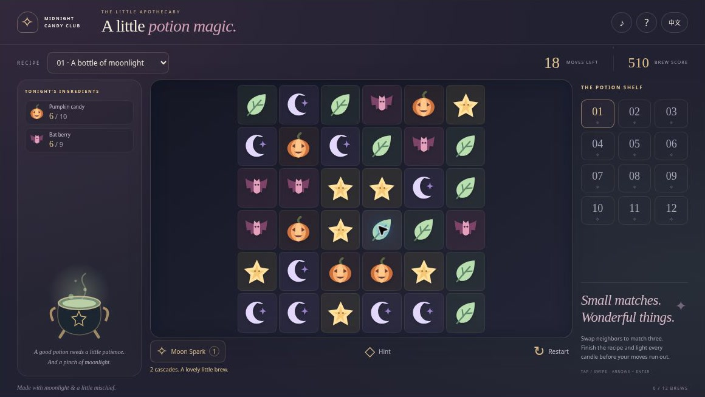
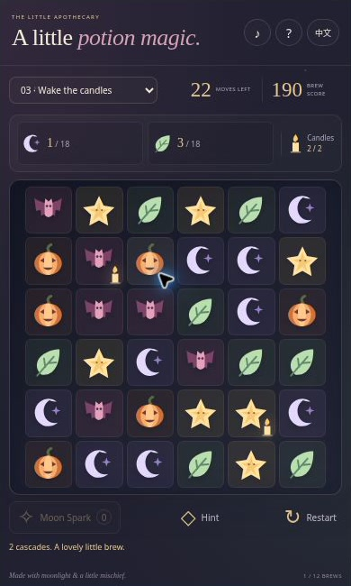

[English](README.md) | [简体中文](README.zh-CN.md) | [Español](README.es.md) | [Português (Brasil)](README.pt-BR.md) | [日本語](README.ja.md)

# 🎃 Witch’s Potion Match — Puzle de combinar 3 de Halloween

**Un poco de luna, un puñado de dulces y otra cascada deliciosa.** Prepara doce pociones de Halloween intercambiando ingredientes ilustrados, completando recetas y encendiendo velas. Este acogedor juego de combinar tres forma parte de Midnight Candy Club y fue creado para [BlockBlasty](https://blockblasty.top/).

**[Jugar ahora](https://halloween-potion-match.crazy3d.org/)** · [Colección de Halloween](https://github.com/AshinTop/halloween-games) · [Guía de integración](EMBEDDING.md) · [Notas de diseño](DESIGN.md)

**Idiomas de la documentación:** English, 简体中文, Español, Português (Brasil), 日本語. **Interfaz del juego:** solo inglés y chino simplificado. Los otros idiomas del README no implican una traducción de los menús del juego.



## ¿Qué hay en el caldero? 👻

- **12 recetas reproducibles** en un tablero de 6×6, con caramelo de calabaza, luz de luna, bayas de murciélago, hojas de menta y polvo de estrellas.
- Intercambios adyacentes, coincidencias simultáneas, gravedad y cascadas. Todas las recetas tienen una solución verificada mediante intercambios normales.
- Objetivos de velas que hacen importante la posición de cada combinación, además de un Moon Spark por receta.
- Destellos de colores, ingredientes que vuelan hacia la receta, caídas coherentes y pequeños rebotes al aterrizar.
- Pistas útiles, selección de recetas, reinicios ilimitados, récords locales, estrellas, sonido opcional y movimiento reducido.

## Cómo preparar una poción

Mira primero las cantidades de la receta. Intercambia dos casillas vecinas para formar una línea horizontal o vertical de al menos tres ingredientes iguales. No se permiten intercambios diagonales ni saltos entre los extremos de una fila. Un intercambio que no forma una combinación no gasta movimientos.

Un intercambio válido cuesta un movimiento, aunque provoque varias cascadas. Las coincidencias que aparecen después de caer también cuentan para la receta. La puntuación aumenta con la profundidad de la cascada: una combinación pequeña puede convertirse en una buena sorpresa.

Algunas recetas incluyen velas. Elimina el ingrediente situado sobre una vela o inmediatamente arriba, abajo, a su izquierda o a su derecha para encenderla. Debes completar **todos los ingredientes y todas las velas**; una sola parte del encargo no basta.

Pulsa **Moon Spark** y elige una casilla. Se elimina su fila y su columna: once casillas distintas en la primera oleada, seguidas de las cascadas normales. Hay una chispa por receta y no consume movimiento. Si llegas a cero movimientos sin haberla utilizado, todavía puedes aprovechar esa última oportunidad.

No hay cuenta atrás. Terminar con ocho movimientos o más da tres estrellas; con tres o más, dos; cualquier otra victoria, una. Las pistas valoran intercambios legales útiles para tus objetivos, pero no prometen que todas las decisiones siguientes terminen en victoria.

## Controles

| Acción | Ratón o pantalla táctil | Teclado |
|---|---|---|
| Elegir e intercambiar | Toca dos vecinas o desliza | Flechas para enfocar; Enter o Espacio para elegir |
| Moon Spark | Botón y después una casilla | Tab al botón, activar y elegir |
| Pista | Botón Hint | H |
| Cancelar selección | Toca otra vez la casilla elegida | Escape |
| Reiniciar o cambiar receta | Botón o selector | Tab al control |

Espera a que termine la cascada antes del siguiente intercambio. Reiniciar y cambiar de receta siguen disponibles durante los efectos: cancelan la secuencia anterior para que no altere el tablero nuevo.

## Recetas, registros y enlaces

La misma receta y las mismas acciones producen los mismos resultados. El navegador guarda mejores puntuaciones, estrellas, idioma y sonido. Recargar reinicia la receta; no recupera una partida a medias. Un enlace a la [receta 8](https://halloween-potion-match.crazy3d.org/#recipe=8) comparte su disposición inicial, no una repetición.

## Preguntas frecuentes

**¿Es obligatorio usar Moon Spark?** No. Las doce recetas tienen comprobaciones de victoria con intercambios normales.

**¿Por qué se reorganizó el tablero?** Si no queda un intercambio legal, se intenta mezclar los ingredientes existentes. Una distribución muy desequilibrada puede necesitar nuevos ingredientes. Se conservan progreso, puntuación y movimientos.

**¿Qué pasa si un efecto se detiene?** La secuencia visual tiene cancelación y protección por tiempo límite. El resultado legal ya calculado puede completarse sin el efecto para que los controles no queden bloqueados.

## Imágenes y vídeo



Interfaz real capturada en un iframe compacto del navegador. Ilustra la distribución de los controles; no es una prueba de rendimiento en un teléfono físico.

[Ver la introducción de 24 segundos](https://halloween-potion-match.crazy3d.org/intro.html) · [Descargar el MP4 con subtítulos](docs/media/intro.mp4). Este vídeo silencioso está montado con capturas reales del juego, no con una partida grabada de forma continua. Las imágenes reflejan la interfaz del momento de la captura y pueden ser anteriores a mejoras visuales posteriores.

## Añádelo a tu sitio

```html
<iframe src="https://halloween-potion-match.crazy3d.org/"
  title="Witch’s Potion Match"
  style="display:block;width:100%;height:654px;border:0"
  allow="fullscreen" allowfullscreen></iframe>
```

Las ventanas objetivo son 1160×654 en escritorio, 390×650 / 390×794 en vertical y 844×340 en horizontal. El tablero usa el espacio real del iframe; estas comprobaciones no certifican todos los dispositivos físicos.

La versión en línea se publica en Cloudflare desde este repositorio de GitHub. Asigna una altura real al iframe y deja espacio para la barra del sitio anfitrión. El sitio puede ofrecer pantalla completa. Consulta [EMBEDDING.md](EMBEDDING.md) para los detalles.

## Ejecutar y comprobar en local

```sh
python3 -m http.server 4173
```

Sirve la raíz del repositorio y abre [http://localhost:4173/](http://localhost:4173/). Es un juego estático, sin compilación ni instalación de dependencias. Usa HTTP(S): abrirlo mediante `file://` puede bloquear los módulos JavaScript. Las pruebas requieren Node.js.

```sh
npm test
```

Las **24 pruebas** cubren reglas, las doce recetas, gestos obsoletos, entradas simultáneas, rutas de caída, contadores por oleada, cancelación y recuperación cuando falla un efecto o deja de avanzar su línea temporal.

El código del juego no necesita cuentas, API remotas, SDK publicitarios ni una CDN de recursos externos. Los registros se guardan en el navegador, sin sincronización en la nube. Cloudflare puede añadir scripts de alojamiento y registros de solicitudes. El sonido sintetizado opcional respeta los permisos del navegador.

## Más aventuras a la luz de la luna 🍬

- [Witch’s Candy Blocks](https://halloween-block-blast.crazy3d.org/) · [Código](https://github.com/AshinTop/halloween-block-blast) — Coloca bloques de caramelo en un tablero 8×8.
- [Pumpkin Shift](https://halloween-pumpkin-shift.crazy3d.org/) · [Código](https://github.com/AshinTop/halloween-pumpkin-shift) — Puzles deslizantes con Moon Glides.
- [Trick-or-Treat TriPeaks](https://halloween-tripeaks.crazy3d.org/) · [Código](https://github.com/AshinTop/halloween-tripeaks) — Solitario de rangos vecinos y Moon Bridges.
- [Moonlit Mirrors](https://halloween-mirror-hearts.crazy3d.org/) · [Código](https://github.com/AshinTop/halloween-mirror-hearts) — Guía a dos fantasmas reflejados hasta casa.

## Créditos y apoyo

Creado para **Midnight Candy Club de AshinTop** mediante colaboración con IA dirigida por personas en diseño, programación, documentación, pruebas y revisión. Las ilustraciones originales y los sonidos sintetizados se hicieron para este proyecto. Consulta las [notas de diseño](DESIGN.md).

¿Te gustó esta pequeña aventura? **[Dale una estrella a Witch’s Potion Match en GitHub](https://github.com/AshinTop/halloween-potion-match)** para encontrarlo después y seguir las novedades. Al informar de un problema, incluye nivel o modo, navegador, tamaño de ventana y pasos para reproducirlo. Descubre la [colección completa de Halloween](https://github.com/AshinTop/halloween-games).
